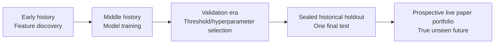
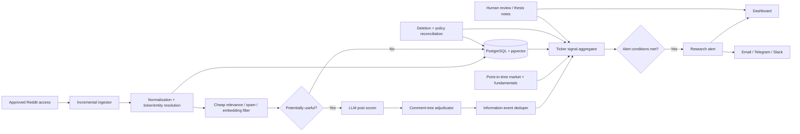
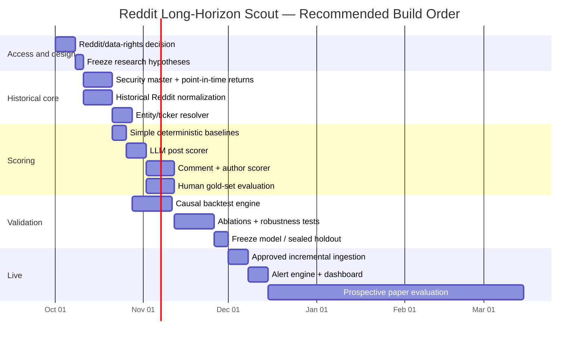

# Designing a Reddit-Based Long-Horizon Stock-Scouting System

## Executive summary

The strongest conclusion from the research is that **you should not build a Reddit sentiment trader**. You should build a **Reddit thesis-discovery and adjudication engine**.

That distinction matters. The academic evidence is fairly hostile to the naïve strategy of counting mentions, averaging sentiment, or buying whatever Reddit likes most. A study of recommendations across r/wallstreetbets, r/stocks, and r/investing found positive short-horizon effects but **significant negative long-horizon risk-adjusted performance at the one-year horizon**. A much richer Oxford-led study similarly concludes that aggregate WallStreetBets metrics are weak predictors, that rapid increases in attention can capture hype/reversal rather than information, and that large popular asset clusters are generally worse than smaller niche clusters. [^1] [^2]

There is, however, a much more interesting signal buried underneath the aggregate crowd. The peer-reviewed *Review of Financial Studies* paper by Bradley, Hanousek, Jame, and Xiao found that **due-diligence recommendations on WallStreetBets predicted subsequent returns and cash-flow news before the January 2021 GameStop episode**, while that informativeness disappeared after the community's influx and cultural change. [^3] Another Oxford study found that external URLs in DD posts tended to become more useful at horizons beyond eight weeks, especially beyond fifteen weeks, and that smaller, niche discussion clusters performed better than large ones. [^2] Earlier social-finance research outside Reddit also found that the information in **both original analyses and the comments responding to them** predicted future returns and earnings surprises. [^4]

That is remarkably close to your intuition:

> A thoughtful poster with a real thesis, intelligently supported or challenged by other thoughtful people, is potentially useful. Ten thousand people yelling “bullish” is mostly noise.

I would therefore make the system optimize for this latent variable:

**“How much new, independently corroborated, falsifiable, financially material information does this conversation contain, and how credible are the people and evidence producing it?”**

Sentiment should be a descriptor of the thesis, **not the primary alpha signal**.

A second conclusion is equally important: **“10x best case / solid growth worst case” cannot literally be guaranteed by stock selection.** Any individual equity can suffer permanent impairment or go to zero. The system can instead search for **asymmetric candidates**: companies with plausible paths to very large upside, while an independent fundamental-quality layer estimates financial resilience. A tenfold return requires roughly 58.5% CAGR over five years, 38.9% over seven years, or 25.9% over ten years. Reddit can help find things the market may be underappreciating; it cannot establish a safe downside floor.

The architecture I recommend has four logically separate engines:

1. **Conversation intelligence:** score Reddit posts, comments, authors, evidence and disagreement.
2. **Information-event detection:** deduplicate related posts so 500 people repeating one news item count as one information event, not 500 independent observations.
3. **Fundamental asymmetry screening:** independently assess balance-sheet survival, dilution, unit economics, valuation, market size and optionality.
4. **Point-in-time validation:** test whether signals that *would actually have been observable on a date* identified subsequent multi-year winners without cheating.

The YouTube experiments you supplied are valuable mostly as a catalogue of what **not** to do. The July experiment initially appeared spectacular because of look-ahead bias; after fixing it, aggregate positive Reddit sentiment produced no usable edge. It also encountered false ticker extraction from ordinary words that happened to be exchange symbols. [^25] The August experiment caught survivorship bias from using only companies that still existed and ultimately found that a sealed out-of-sample model was statistically indistinguishable from the market. [^26] The November experiment's useful ideas are multi-horizon predictions, explicit uncertainty, and comparison against distributions of random portfolios rather than merely asking whether a backtest made money. [^27]

There is one major 2026 implementation caveat: **the historical “Reddit scraper” should not literally be an unauthorized scraper.** Reddit's Responsible Builder Policy, updated June 5, 2026, says explicit approval is required before accessing Reddit data through its API, prohibits circumventing limits, says research using Reddit data outside the Reddit for Researchers program violates that policy, and prohibits unapproved mining/scraping and uses such as AI training. Reddit's Data API documentation also requires deletion of deleted content and author-identifying information, and states a free eligible API rate limit of 100 queries per minute per OAuth client ID averaged over ten minutes. [^5] [^6]

So my recommended sequence is:

**Get the data rights straight first → construct a point-in-time historical corpus → build a deliberately simple quality scorer → validate on sealed periods → only then add a live alert system.**

The single biggest modeling priority should be **quality of information, not sophistication of model**.

## Research evidence and what it implies

The academic literature does not give us a finished “10x Reddit model,” and medium-to-long-horizon Reddit work is much thinner than short-term sentiment/event studies. But several results provide unusually clear design guidance.

| Study | Data / horizon | Main result relevant here | What I would encode |
|---|---|---|---|
| Bradley, Hanousek, Jame & Xiao, *RFS* 2024 | WallStreetBets DD reports; pre/post GameStop regimes | DD recommendations predicted subsequent returns and cash-flow news before GameStop; predictive power disappeared afterward as attention/price-pressure content increased. [^3] | Score **research quality** and regime/community quality, not “Reddit” generically. |
| Semenova et al., *Journal of Portfolio Management* / Oxford | WSB 2012–2022; models out to 24 weeks | Aggregate WSB signals weak; URLs were more often positively useful beyond 8 weeks and especially >15 weeks; niche clusters looked better than large clusters. [^2] | Give evidence-bearing links, niche expertise and low crowd saturation substantial weight. |
| Reichenbach & Walther, *Digital Finance* 2023 | r/wallstreetbets, r/stocks, r/investing, 2008–Aug. 2022 | Mention-weighted recommendation portfolios had unfavorable Sharpe ratios; alpha became significantly negative at one-year horizons. [^1] | Raw popularity/mention counts should be a **hype variable**, not an investment score. |
| Chen, De, Hu & Hwang, *RFS* 2014 | Investor social-media analyses **and their comments** | Views expressed in both articles and commentaries predicted future stock returns and earnings surprises. [^4] | Independently score the comment section; agreement backed by reasoning can add information. |
| Breitmayer, Massari & Pelster, *IREF* 2019 | 14.9m structured stock assessments, 10,452 stocks | Crowd opinions had explanatory power for future/abnormal returns; reported portfolio excess return was 3.3% monthly in their setting. [^7] | Aggregation can work when opinions are structured and sufficiently independent. |
| Gu & Kurov, *Journal of Banking & Finance* | Firm-specific Twitter/StockTwits sentiment | Sentiment predicted returns without later reversal; analyst actions and earnings information explained part of the effect. [^8] [^9] | Ask **what information causes the sentiment**, rather than treating sentiment itself as causal. |
| Da, Gurun & Warachka, *RFS* 2014 | General information/momentum research, not Reddit | Gradually arriving information was associated with persistent continuation; greater media attention mitigated it. [^10] | Early, quiet, accumulating evidence is a more plausible long-horizon target than viral news. |
| Balasubramaniam & Sabat, *RCFS* 2026 | Comment-tree disagreement on WSB | First-round disagreement was most related to trading activity; deeper discussion became progressively less informative for those market outcomes. [^11] | Tree position is useful metadata; do not assume a 200-reply thread contains 200 independent signals. |

The Bradley paper is particularly important for your heuristic. It says, in effect, that **there really was useful stock research inside WSB**, but it was conditional on the community regime. The finding disappeared when the population and posting incentives changed. [^3] That strongly argues against assigning a permanent “r/wallstreetbets quality = 0.7” parameter. Subreddit quality, author quality and signal calibration need to be **rolling, time-varying variables**.

The Oxford “Wisdom of the Crowds or Ignorance of the Masses?” analysis is even closer to the desired system. The authors manually screened DD, hand-labelled 4,000 WSB posts as bullish, bearish or neutral, and fine-tuned FinBERT to 69.2% test accuracy. They then examined 3,744 return-prediction specifications from the next day through 24 weeks. Their overall conclusion was not that sentiment is magic; it was that WSB provides at most **weak signals that can complement other factors**. [^2]

Two details from that study deserve to become explicit features in your model. First, the presence of an external URL was more likely to have a positive coefficient for horizons beyond eight weeks and especially beyond fifteen weeks. Second, large asset-discussion clusters generally performed poorly while smaller niche clusters showed more promise. [^2] This supports a design in which “here is a primary source and here is why the market is missing it” outranks “everyone suddenly loves this ticker.”

The paper also found that changing normalized sentiment could negatively predict the following month's return and interpreted rising discussion momentum partly as a hype-reversion phenomenon. [^2] In your system, therefore, **viral popularity should eventually become a penalty**. An excellent thesis discovered when a stock is obscure is more interesting than the same thesis after the stock has become the most discussed thing on the platform.

Reichenbach and Walther provide a complementary warning. Their very simple mention/recommendation portfolios across the three major finance subreddits produced significant one- and three-month effects in some specifications but significant underperformance by the one-year horizon; all three subreddit portfolios showed significant negative annual excess returns. [^1] That is almost the opposite objective from yours. You are specifically trying to avoid being the guy who buys whatever Reddit is currently excited about.

The wider social-media literature gives a plausible mechanism for why a selective system could nevertheless work: online communities sometimes contain **fundamental information before it is fully incorporated into prices**. Chen et al. found predictive information in both analyses and reader responses; Gu and Kurov tied part of social-media predictive content to forthcoming analyst actions and earnings information; Breitmayer et al. found value in a structured crowd consensus. [^4] [^8] [^7] The target should therefore be *information discovery*, not mood discovery.

That yields a testable core hypothesis:

> **H₁:** Stocks associated with unusually high-quality, externally supported, independent, early-stage Reddit investment theses subsequently outperform comparable stocks over multi-year horizons, even after controlling for momentum, size, sector, valuation, broad Reddit attention, and market regime.

A second hypothesis captures your comment heuristic:

> **H₂:** Evidence-bearing agreement from independently credible commenters adds predictive information beyond the original post, whereas low-information agreement or disagreement does not.

A third captures the “next Nvidia before everyone knows it” idea:

> **H₃:** High thesis quality combined with **low-to-moderate crowd saturation** is more predictive of extreme positive outcomes than high thesis quality after attention has become ubiquitous.

These are substantially better hypotheses than “positive Reddit sentiment predicts stocks.”

Your attached July transcript reaches essentially the same negative conclusion by experimentation: once its look-ahead bug was fixed, its simple bullish-minus-bearish strategy stopped working. [^25] Its description of the Oxford paper's niche-cluster finding is directionally consistent with the actual study. [^2]

The public GitHub ecosystem also shows that the mechanical ingestion layer is not novel: existing projects already combine Reddit ingestion, ticker extraction, sentiment models, Elasticsearch/FastAPI or relational backends, dashboards and Telegram alerts. For example, `sentiment-scanner` uses Reddit/StockTwits, Elasticsearch, FastAPI, VADER/FinBERT and Telegram notifications. [^12] The losingloonies Sponsors page associated with the material you supplied advertises the WSB-related code as sponsor/private material rather than a fully public repository, so I would treat the transcripts as conceptual input rather than audited production code. [^13]

**The moat, if there is one, is not scraping Reddit. It is correctly measuring information quality without hindsight.**

## Data acquisition, schema and indexing

The data problem has two very different halves: **historical reconstruction** for backtesting and **forward snapshots** for live operation. They should not be conflated.

### Acquisition options

| Method | Historical depth | Live suitability | Compliance position in 2026 | Recommendation |
|---|---:|---:|---|---|
| Approved Reddit Data API | Limited by available/listing interfaces; should not be assumed to reconstruct an arbitrary one-year/full-history corpus | Excellent once approved | Explicit approval required; OAuth and API limits apply. [^5] [^6] | **Preferred live source** |
| Devvit / Reddit Developer Platform | Not designed as a general historical warehouse | Excellent for apps operating inside Reddit's supported model | Reddit says developers should use Devvit and directs unsupported cases to request review. [^5] | Useful only if your use case fits platform review |
| Reddit for Researchers | Five years of history, six-month lag, updated monthly | Poor for live investment alerts | Requires accredited university affiliation, institutional email, proposal and IRB/ethics review; access max one year. [^14] | Excellent academic route, probably unavailable for a personal investing project |
| Reddit-approved/licensed historical dataset | Potentially deep | Depends on provider | Must verify that both provider **and your intended use** are authorized | **Best practical historical route if available** |
| Legacy Pushshift dumps | Historically excellent; used by many papers | Not appropriate as current live foundation | Current Reddit policy makes unauthorized mining/research problematic; Oxford's historical study used Pushshift under an earlier environment. [^2] [^5] | Do not make this the compliance foundation in 2026 |
| Direct HTML scraping / rotating accounts / bypassing limits | Potentially broad | Technically possible | Conflicts with Reddit's explicit anti-circumvention and approval requirements. [^5] | **Do not use** |

This changes one part of your original specification. The system should *conceptually* stand itself up with the prior year of posts, but you should only bootstrap that year if you have an approved source entitled to provide it. Reddit's modern Developer API examples also expose listing calls with limits up to 1,000 items, which is another reason not to assume ordinary feed pagination is a historical archive. [^15]

For live approved API usage, Reddit currently states 100 queries per minute per OAuth client ID for eligible free access, averaged over a ten-minute window, and requires OAuth rather than unauthenticated traffic. [^6] That is more than enough for a thoughtful low-frequency scout if ingestion is incremental and comment refreshes focus on promising threads.

### The snapshot problem

A subtle but critical point: **historical Reddit data does not necessarily tell you what Reddit looked like when you would have made a decision.**

Suppose a thread was posted Monday at noon:

- At 12:05 it had 3 comments and a score of 8.
- By midnight it had 80 comments and a score of 2,000.
- Three days later it had 600 comments.
- You backtest a system that supposedly alerts at 12:30 but feed it the final score and full comment tree.

That is look-ahead bias just as surely as feeding tomorrow's stock price into the model.

Therefore every observation should have both:

`created_at` — when Reddit says the object was created.

`observed_at` — when **your system actually observed this version** of it.

For historical archives that lack time-stamped vote/comment snapshots, you have two defensible choices:

**Backtest text-only features** that existed at initial publication; or define a fixed maturation delay, such as T+24 hours, and only use fields demonstrably available by that cutoff. Do not pretend today's final karma existed ten minutes after publication.

For the forward system, deliberately create your own permitted snapshots at intervals such as 10 minutes, 1 hour, 6 hours, 24 hours and 72 hours. This produces the dataset you will wish you had three years from now.

Reddit exposes vote **score** and `upvoteRatio` in its current developer interfaces; a developer-platform implementation explicitly notes that raw separate upvote/total-vote counts are not exposed as such. [^16] [^17] So the requested “upvote/downvote counts” should be represented as the lawful fields Reddit actually supplies, not fabricated counts.

### Recommended normalized schema

The database should preserve provenance and make every feature reproducible.

| Entity | Fields worth storing |
|---|---|
| `post` | Reddit post ID/fullname; subreddit; `created_at`; `observed_at`; title; body; flair; permalink; outbound URL/domain; Reddit score; upvote ratio if exposed; comment count; edit flag/time; stickied/distinguished status; crosspost metadata; award/gilding fields when supplied; deletion/removal status |
| `comment` | Comment ID; post ID; parent ID; depth; `created_at`; `observed_at`; body; score; edit state; distinguished status; awards where available; pseudonymous author key; deletion status |
| `author_snapshot` | Pseudonymous internal author key; observation date; only permitted public/relevant reputation fields; subreddit-specific history summaries; **no inferred sensitive characteristics** |
| `external_link` | Canonical URL; domain; first-seen time; linked post/comment; publication timestamp when determinable; content type; primary/secondary-source classification; dead-link state |
| `security` | Stable security ID; historical ticker; current ticker; company aliases; CIK or equivalent identifier; exchange; security type; corporate-action mapping |
| `mention` | Post/comment ID; candidate ticker/company; character span; extraction method; entity confidence; stance; investment horizon |
| `llm_assessment` | Prompt version; model version; input hash; as-of timestamp; structured JSON scores; confidence; explanation; extracted claims |
| `information_event` | Semantic cluster ID; ticker; first-seen timestamp; canonical claim/event; independent-source count; duplicated-post count |
| `ticker_signal` | Ticker; timestamp; component scores; aggregate score; score delta; uncertainty; crowd saturation; manipulation risk |
| `market_snapshot` | Stable security ID; date; adjusted price/returns; market cap; volume; fundamentals; splits/dividends; delisting information |
| `backtest_label` | 6m/1y/3y/5y returns; benchmark excess; maximum drawdown; 2x/5x/10x status; time-to-target; delisting/permanent-loss flag |

**Ticker resolution is worth far more engineering than it initially appears.** Reichenbach and Walther explicitly had to deal with English words that are valid stock symbols and required `$` prefixes for ambiguous symbols. [^1] Your July transcript independently demonstrates the same failure: ordinary words such as “tech,” “bull,” or “meme” can be misinterpreted as tradable symbols. [^25]

I would implement entity resolution as a cascade:

`$NET` → almost certain ticker.

`NET` + financial syntax/context → high confidence.

`Cloudflare` → alias lookup → NET.

`network / net income` → reject.

`FB` in 2019 → map point-in-time to Facebook/Meta using historical symbol data.

`META` in ordinary English → require company context.

Every ticker must ultimately map to a **stable security identifier**, not merely a string. Otherwise ticker changes, mergers, bankruptcies and reused symbols contaminate long-horizon labels.

For offline research, my preferred storage combination is:

| Stack | Strength | Weakness | Best role |
|---|---|---|---|
| DuckDB + partitioned Parquet | Extremely simple, fast analytical scans; cheap local research | Not ideal as live mutable multi-user system; deletion cascades require care | Historical/backtest research |
| PostgreSQL + pgvector | Relational integrity, SQL, JSON, vectors in one system; easy MVP operations | Less specialized than dedicated search/analytics products | **Recommended live MVP** |
| OpenSearch / Elasticsearch | Excellent full-text search, faceting and high-volume document retrieval | Heavier operations and more duplication | Add when the corpus/search UI justifies it |
| ClickHouse | Excellent high-volume event/time-series analytics | Less natural as system-of-record for mutable Reddit objects | Large-scale analytics later |
| Dedicated vector DB | Strong nearest-neighbor retrieval | Yet another database and source of truth | Only after pgvector becomes limiting |

An existing open-source Reddit sentiment project demonstrates the Elasticsearch/FastAPI pattern, but you do not need that operational complexity initially. [^12] I would start with **Postgres/pgvector for the live system and DuckDB over compliant exports for backtesting**.

Critically, Reddit requires deletion handling. Its Data API guidance says deleted posts/comments must be removed from your possession; if an account is deleted, related identifying information must also be removed, and retention of content that has been deleted is not permitted even when disassociated or anonymized. Reddit strongly recommends routines that reconcile stored content with deletions within 48 hours. [^6] Therefore raw-content storage needs a deletion index and cascades through text, embeddings, cached LLM inputs and other derivatives whose retention would conflict with the applicable agreement. For any long-lived historical corpus, obtain the specific retention rights in writing rather than assuming a personal database is exempt.

## Scoring model, features and LLM prompts

The crucial modeling decision is to **separate direction from quality**.

A beautifully argued bearish thesis and a beautifully argued bullish thesis can both deserve a quality score of 95. “Bullishness” should not make an argument smart.

For each thread, produce at least these independent outputs:

\[
\text{Stance} \in [-1,1]
\]

\[
\text{ThesisQuality} \in [0,100]
\]

\[
\text{ManipulationRisk} \in [0,1]
\]

\[
\text{Confidence} \in [0,1]
\]

\[
\text{ExpectedHorizon} \in
\{\text{days,weeks,months,years}\}
\]

### Thesis-quality score

A sensible **starting hypothesis**, explicitly to be backtested rather than assumed correct, is:

\[
Q = 100(
0.22A +
0.16E +
0.15C +
0.15R +
0.10N +
0.08F +
0.06H +
0.08B)
-25M-15U
\]

where:

| Symbol | Meaning | What earns a high score |
|---|---|---|
| \(A\) | Argument quality | Clear causal mechanism: “X changes economics because Y,” rather than vibes |
| \(E\) | Evidence quality | Filings, transcripts, technical documentation, credible industry sources, quantitative evidence |
| \(C\) | Author credibility | Prior *point-in-time* record, domain consistency and source accuracy |
| \(R\) | Independent corroboration | Strong commenters provide independent reasoning/evidence |
| \(N\) | Novelty | Not merely repeating the existing Reddit consensus |
| \(F\) | Falsifiability | Explicit conditions under which thesis is wrong |
| \(H\) | Long-horizon fit | Competitive advantage, secular trend, economics; not tomorrow's squeeze |
| \(B\) | Balance | Meaningfully addresses valuation, competition and contrary evidence |
| \(M\) | Manipulation risk | Coordinated/repetitive/promotion-like behavior |
| \(U\) | Crowd saturation | Idea already viral and broadly repeated |

The emphasis on evidence and URLs is empirically motivated by the Oxford WSB study's finding that an external URL became particularly interesting at longer horizons, while its weak aggregate predictive results argue against making raw sentiment the dominant component. [^2]

Notice that **sentiment has zero direct weight in \(Q\)**. It determines *direction*, not intellectual merit.

### Author credibility

Your notion of “this sounds like a person who knows what the fuck they're talking about” can be made more rigorous without pretending that karma equals expertise.

I would initialize:

\[
C =
0.45P +
0.20D +
0.15S +
0.10I +
0.10K
\]

where \(P\) is prior predictive/calibration history, \(D\) is demonstrated domain consistency, \(S\) is historical source quality/accuracy, \(I\) is intellectually honest behavior such as acknowledging failed theses, and \(K\) is conventional community reputation/activity.

The important word is **prior**. When scoring a 2018 post, the author's credibility may use their history **before that post**, not their brilliant 2020 call. Anything else leaks the future.

For outcome-based reputation, use shrinkage rather than raw batting average. A Redditor who has made one spectacular call should not instantly outrank someone with 40 moderately successful theses. Conceptually:

\[
\widehat{\alpha}_{author}
=
\frac{n}{n+k}\alpha_{observed}
+
\frac{k}{n+k}\alpha_{population}
\]

where \(k\) controls how rapidly the model trusts individual history.

Track multiple dimensions rather than one magic score:

- percentage of historical bullish calls outperforming size/sector-matched controls;
- average 1y/3y excess return;
- downside rate;
- probability calibration;
- quality of cited evidence;
- domain specialization;
- tendency to delete/abandon losing theses, to the extent permitted data allows this to be measured causally.

Do **not** infer demographics, politics, health, identity or other sensitive characteristics. Reddit explicitly prohibits deriving sensitive characteristics or attempting to deanonymize Redditors. [^5]

### Commenter corroboration

This is where I would depart most strongly from generic sentiment systems.

Every substantive comment gets:

\[
c_i =
s_i \times q_i \times e_i \times a_i \times u_i
\]

where:

- \(s_i\): support/opposition in \([-1,1]\);
- \(q_i\): argument quality;
- \(e_i\): strength of evidence;
- \(a_i\): prior author credibility;
- \(u_i\): independence/uniqueness.

Then:

\[
R = f\left(\sum_i c_i\right)
\]

with a saturating function so twenty similar replies do not overwhelm one excellent dissent.

This recreates your desired heuristic:

**Smart supporter with independent evidence:** strong positive contribution.

**Smart critic exposing a concrete flaw:** strong negative contribution.

**“LFG 🚀” supporter:** approximately zero.

**“lol bagholder” critic:** approximately zero.

**Ten accounts repeating the same talking point:** approximately one correlated information source, not ten.

The Chen et al. finding that commentaries themselves contained predictive information provides unusually direct academic support for treating replies as an independent signal source rather than engagement metadata. [^4]

The system should explicitly extract the **strongest opposing argument**. A candidate that scores 90 because the LLM ignored the one engineer in the thread explaining a fatal technical issue is exactly the failure mode you're trying to avoid.

### Novelty and crowd saturation

Novelty can be estimated from three sources:

\[
N =
w_1 \cdot \text{semantic novelty}
+
w_2 \cdot \text{claim novelty}
+
w_3 \cdot \text{source novelty}
\]

For every new post, retrieve the closest posts about that ticker from the prior 30, 90 and 365 days. Ask whether it introduces:

- a genuinely new fact;
- a new interpretation of known facts;
- a newly emerging industry development;
- merely the same thesis with different wording.

Then separately estimate **saturation**:

\[
U_i(t)=
\operatorname{percentile}
\left(
\frac{\text{ticker mentions}_{i,t}}
{\text{all finance mentions}_t}
\right)
\]

A post about an excellent company when almost nobody discusses it is more interesting for this system than the same post when 20% of all finance Reddit traffic is discussing it. That is an inference motivated by the evidence that large WSB clusters and rapidly rising hype were generally poorer signals than niche discussion. [^2]

### Coordination and astroturfing risk

Do not ask the LLM “is this person a bot?” Ask it and deterministic models to estimate a **coordination/promotion risk**.

Useful features include:

- near-duplicate text across users/subreddits;
- unusually synchronized mention bursts;
- unusually concentrated account-age/activity distributions when those data are authorized;
- repeated linking to one domain;
- many nominally different commenters making semantically identical arguments;
- circular interaction networks;
- repeated promotional language;
- disproportionate posting about one ticker;
- many crossposts with minimal original analysis.

Semantically cluster all posts and comments around an information event. Then cap the influence of each cluster. A press release reposted by 300 accounts remains one new fact.

Reddit itself prohibits content manipulation and app-based vote manipulation, reinforcing the desirability of treating suspicious coordination as a risk rather than social proof. [^18] [^19]

### Time decay

I would not use one universal half-life.

Use:

\[
w(\Delta t,h)=
e^{-\ln(2)\Delta t/h}
\]

and estimate \(h\) separately by information type.

Starting grid for backtesting:

| Signal type | Candidate half-lives |
|---|---:|
| Pure sentiment / enthusiasm | 7, 14, 30 days |
| Attention/mention anomaly | 14, 30, 60 days |
| Competitive or product thesis | 60, 120, 180 days |
| Verified fundamental information | 90, 180, 365 days |
| Author reputation | 365, 730 days |
| Known dated catalyst | Decay relative to event date, not generic half-life |

The Oxford results suggest that external-evidence effects can persist into multi-month horizons while aggregate hype can revert, which is precisely why those signals should decay differently. [^2]

### Ticker-level score

Let thread \(j\)'s signed contribution be:

\[
x_j =
d_j
\left(\frac{Q_j}{100}\right)^2
p_j
u_j
(1-M_j)
\]

where:

- \(d_j\) = bullish/bearish stance;
- \(Q_j\) = quality;
- \(p_j\) = LLM confidence;
- \(u_j\) = independence after semantic clustering;
- \(M_j\) = manipulation risk.

Then:

\[
S_i(t)
=
\sum_{j\in i}
x_j
e^{-\ln(2)\Delta t_j/h_j}
\]

Normalize the result to a 0–100 percentile within the cross-section rather than pretending the raw number has universal meaning.

I would actually expose multiple ticker scores in the UI:

**Research Signal:** quality-weighted directional conviction.

**Independent Evidence:** number/strength of distinct information sources.

**Expert Consensus:** credible support minus credible opposition.

**Crowd Saturation:** how widespread the idea already is.

**Manipulation Risk:** coordination/promotional indicators.

**Fundamental Resilience:** independent, non-Reddit company-quality assessment.

**Asymmetry Score:** combined rank used to generate research alerts.

That transparency is much safer than a single opaque `87.3 = BUY`.

### Fundamental resilience should remain separate

Reddit cannot establish your “solid company worst case.” That requires a second data layer looking at things such as balance-sheet liquidity, leverage, share-count dilution, revenue quality, free-cash-flow trajectory, unit economics, competitive concentration and valuation.

I would not let a Reddit score rescue a company that fails your hard financial survivability rules. Conversely, a financially excellent company can remain on a watchlist even if Reddit becomes temporarily negative.

Think of the system as:

\[
\text{Candidate}
=
\text{Reddit Discovery}
\times
\text{Fundamental Survivability}
\times
\text{Upside Optionality}
\]

not:

\[
\text{Candidate} = \text{Reddit likes it}
\]

### Prompt template for a post

```text
SYSTEM

You are evaluating an investment argument as it existed at {AS_OF_TIMESTAMP}.

CRITICAL RULES:
1. Use ONLY the supplied post, supplied contemporaneous context, and sources
   dated on or before {AS_OF_TIMESTAMP}.
2. Do not use knowledge of what happened to the company after that timestamp.
3. Do not reward technical vocabulary merely because it sounds sophisticated.
4. Separate bullish/bearish DIRECTION from ARGUMENT QUALITY.
5. Treat popularity, karma, awards, and confident language as weak evidence.
6. Distinguish primary evidence, secondary evidence, hearsay, and unsupported claims.
7. Identify what would falsify the thesis.
8. Identify whether this is a multi-year investment thesis, a short-term catalyst,
   a squeeze/momentum trade, or unclear.
9. Return valid JSON only.

POST:
{POST_TEXT}

LINK METADATA AVAILABLE AS OF TIMESTAMP:
{LINKS_AND_METADATA}

RECENT PRIOR DISCUSSION OF THIS COMPANY:
{RETRIEVED_PRIOR_POST_SUMMARIES}

Return:
{
  "ticker_candidates": [],
  "stance": -1.0 to 1.0,
  "horizon": "days|weeks|months|years|unclear",
  "argument_quality": 0-100,
  "evidence_quality": 0-100,
  "falsifiability": 0-100,
  "novelty": 0-100,
  "long_horizon_relevance": 0-100,
  "balance_and_counterarguments": 0-100,
  "promotion_hype_risk": 0-100,
  "claims": [
    {
      "claim": "...",
      "evidence_type": "primary|secondary|hearsay|none",
      "materiality": 0-100,
      "novelty": 0-100
    }
  ],
  "strongest_bull_case": "...",
  "strongest_bear_case": "...",
  "falsification_conditions": [],
  "confidence": 0-1,
  "reasoning_summary": "brief explanation grounded only in supplied evidence"
}
```

### Prompt template for the comment tree

```text
SYSTEM

Evaluate whether the discussion below adds INDEPENDENT information to the
original investment thesis.

Do not count repetition or popularity as corroboration.

For each substantive comment:
- Is it supporting, opposing, or neutral?
- Does it introduce evidence or reasoning not already present?
- How strong is the argument?
- Does the commenter demonstrate relevant expertise from the supplied
  prior-history features?
- Is the comment merely social reinforcement?
- Is it semantically duplicated by other comments?

Then identify:
1. strongest independent corroboration;
2. strongest informed objection;
3. unresolved factual dispute;
4. evidence that materially changes the original thesis;
5. potential coordinated/promotional behavior.

Return JSON with per-comment scores plus:
{
  "independent_support_score": 0-100,
  "independent_opposition_score": 0-100,
  "net_corroboration": -100 to 100,
  "effective_independent_commenters": number,
  "coordination_risk": 0-100,
  "thesis_update": -50 to 50
}
```

### Example scoring

Imagine a fictional small-cap infrastructure company, **XYZC**.

A 3,000-word post argues that a new product changes XYZC's addressable market, links a new regulatory filing and customer documentation, models unit economics, identifies two serious competitors, and states exactly which revenue milestones would falsify the thesis. It has only 70 upvotes. Three commenters with credible prior industry discussions independently confirm technical details; one informed critic challenges customer-concentration assumptions and the author modifies the model.

Possible score:

| Component | Score |
|---|---:|
| Argument | 92 |
| Evidence | 95 |
| Author credibility | 75 |
| Independent corroboration | 88 |
| Novelty | 90 |
| Falsifiability | 90 |
| Horizon | 95 |
| Balance | 86 |
| Manipulation risk | 5 |
| Crowd saturation | 10 |
| **Approximate thread quality** | **high-80s** |

Now imagine a second XYZC post: “THIS IS THE NEXT NVDA, 50x EASY,” 12,000 upvotes, screenshots of recent price gains, no valuation work, and hundreds of nearly identical replies.

That post should score perhaps 10–25 on investment quality regardless of sentiment and engagement.

**Your system should be specifically built to prefer the first post.**

## Backtesting and statistical validation

For your purpose, I would make **candidate discovery** the primary backtest and portfolio simulation secondary.

A normal trading backtest asks:

> Did this buy/sell rule make money?

Your actual question is closer to:

> When my system said “this company deserves serious research,” did those companies subsequently contain a disproportionate number of extraordinary long-term winners without an unacceptable rate of catastrophic failures?

That is a better objective.

### Point-in-time universe

Do **not** build the universe from today's surviving ticker list. Your August transcript correctly identified why this is catastrophic: companies that disappeared through bankruptcy, delisting or acquisition vanish from the sample and make historical performance look magically good. [^26]

The security master should therefore contain, point-in-time:

- listed stocks on each historical date;
- historical ticker aliases;
- delisted securities and delisting returns;
- bankruptcies;
- mergers/acquisitions;
- stock splits and distributions;
- market cap and liquidity available at that date.

For your stated willingness to take small-cap moonshots, do not restrict the main universe to today's S&P 500. A useful primary universe is **all eligible U.S. common equities above a point-in-time minimum liquidity/market-cap threshold**, with separate analyses for micro-, small-, mid- and large-cap names.

### Outcome labels

Do not optimize only for “10x yes/no.” Ten-baggers are rare, and recent cohorts have not had enough time to become one.

For every alert, calculate:

| Label family | Outcomes |
|---|---|
| Ordinary return | 6m, 1y, 3y, 5y CAGR |
| Relative return | excess return vs broad market; size/sector-matched excess |
| Convex upside | touched 2x, 5x or 10x within 3/5/7/10 years |
| Downside | maximum drawdown; −50% event; −80% event; bankruptcy/delisting |
| Path | time to 2x/5x/10x; drawdown before eventual target |
| Risk-adjusted | Sharpe, Sortino, Information Ratio |
| Calibration | observed success frequency vs predicted probability |
| Ranking | precision@K, recall@K, NDCG / top-decile lift |

The **10x hit rate** should be accompanied by **10x recall**:

\[
\text{Precision}_{10x}
=
\frac{\text{selected stocks that 10x}}
{\text{all selected stocks}}
\]

\[
\text{Recall}_{10x}
=
\frac{\text{10x stocks selected early}}
{\text{all eligible stocks that subsequently 10x}}
\]

You care about both. A model that finds two ten-baggers in twenty picks may be valuable; a model that finds two while missing 150 obvious ones may not be learning what you think it is.

Use time-to-event/survival methods for ten-bagger outcomes because later cohorts are **right-censored**. A 2025 stock that is up 80% by September 2026 has not “failed” to 10x over ten years; it simply has not had ten years.

### Signal horizons

I would run the following primary experiment matrix:

| Dimension | Values |
|---|---|
| Reddit history available to scorer | 7d, 30d, 90d, 180d, 365d |
| Thread maturation | initial text only; 6h; 24h; 72h |
| Signal half-life | 30d, 60d, 120d, 180d |
| Minimum quality | 60, 70, 80, 90 |
| Independent evidence requirement | none; ≥2 sources; ≥3 sources |
| Crowd saturation | unrestricted; below 90th percentile; below 75th |
| Market cap | all; micro; small; mid; large |
| Holding/evaluation horizon | 1y, 3y, 5y, 7y, 10y where observable |
| Exit | fixed horizon; persistent thesis degradation; combined |
| Benchmark | broad market; sector; size × sector |
| LLM | baseline deterministic/NLP; small LLM; strong LLM |
| Comments | excluded; raw; quality-weighted |
| Author history | excluded; karma only; causal track record |
| Novelty | excluded; embedding novelty; claim-level novelty |
| Fundamentals | no filter; weak resilience gate; strict resilience gate |

Do **not** casually search all combinations and report the winner. Bailey and López de Prado's Deflated Sharpe Ratio work exists precisely because the apparent best strategy becomes increasingly likely to be a statistical accident as the number of tried variants grows. [^20] Keep a permanent **experiment ledger** recording every model/configuration tested.

### Entry timing

For a 24-hour maturation configuration:

1. Post appears Monday 13:42.
2. System may use only information received through Tuesday 13:42.
3. Candidate is generated Tuesday 13:42.
4. Hypothetical investment occurs at the **next realistically executable market observation after 13:42**, including any modeled slippage.
5. Nothing posted after the cutoff can affect that signal.

That sounds obvious, but your July transcript's spectacular initial result was produced by exactly this class of timing error. [^25]

### Historical LLM leakage

This deserves special emphasis because it is an easy way for a modern LLM backtest to become completely fake.

Suppose you give a 2020 NVIDIA thesis to a 2026-capable model and ask, “How good was this thesis?” Even with no web access, the model may know that NVIDIA subsequently exploded. It can unconsciously reward the argument because it recognizes the ticker and outcome.

Solutions, from strongest to weakest:

**Ticker-blinded quality test:** replace company/ticker identity with stable placeholders where feasible and ask the model only to judge reasoning and evidence.

**Controlled contemporaneous context:** supply only documents dated before the scoring timestamp and explicitly prohibit outside knowledge.

**Model-vintage holdout:** use an LLM whose training cutoff predates the evaluation period, when feasible.

**True forward validation:** after freezing the model, run it prospectively for 12–36 months. This is ultimately the cleanest test.

At minimum, run both identified and anonymized historical scoring. If performance collapses when the company name disappears, assume substantial hindsight contamination until proven otherwise.

### Baselines

The system must beat far more than SPY.

Compare against:

- random eligible stocks;
- size/sector-matched random stocks;
- simple past momentum;
- simple Reddit mention count;
- simple Reddit sentiment;
- karma-weighted sentiment;
- quality score without comments;
- quality + comments;
- quality + comments + author reputation;
- quality + novelty;
- fundamentals alone;
- combined Reddit + fundamentals.

The random-portfolio distribution in your November transcript is the right instinct: beating a single arbitrary baseline is insufficient. [^27]

### Portfolio simulation

Even though you're not designing a frequent trader, I would still create one portfolio-level diagnostic:

- candidate review monthly;
- choose top \(K\) qualifying names;
- equal weight initially;
- cap single-name exposure;
- rebalance only when a name exits or a scheduled review occurs;
- test three- and five-year horizon variants;
- include realistic trading frictions;
- compare against matched benchmark portfolios.

Report:

\[
CAGR
\]

\[
\text{Information Ratio}
=
\frac{E[R_p-R_b]}
{\sigma(R_p-R_b)}
\]

plus maximum drawdown, volatility, Sortino ratio, hit rate, skew, top-contributor concentration and turnover.

Given the goal, however, **the distribution of individual candidate outcomes matters at least as much as portfolio Sharpe**. A strategy with a few extraordinary 30x winners and many intentionally tiny losing positions can look strange under conventional mean-variance metrics while still matching your investment philosophy.

### Statistical significance

Long-horizon labels overlap heavily. A stock selected in January 2020 and another selected in February 2020 share much of the same three-year macro environment; they are not independent observations.

I would therefore use:

**Block bootstrap:** resample calendar blocks rather than individual observations.

**Ticker/sector-aware resampling:** avoid treating repeated signals on one company as independent discoveries.

**Permutation test:** within each date/sector/size bucket, shuffle ticker assignments to ask whether the scorer beats what one would obtain merely from being exposed to that type of stock.

**Walk-forward evaluation:** train and tune on past periods, then move forward without peeking.

**Embargoed folds:** because a five-year label overlaps subsequent training data, leave sufficiently large embargoes between train and test segments.

**Multiple-testing correction / DSR:** count every material configuration trial. The Deflated Sharpe Ratio explicitly adjusts performance significance for selection bias and non-normal returns. [^20]

Most importantly, create a **sealed final holdout** that cannot be repeatedly consulted during development. Your August transcript eventually did this and found that an apparently strong strategy did not outperform the market on the held-out period. [^26]

A good temporal design might look like:



No parameter should move after seeing the sealed test without declaring that test contaminated and creating a new future holdout.

### The most important ablation tests

The research question is not merely whether the complete model works. You need to know **why**.

I would insist on these tests:

| Variant | Question answered |
|---|---|
| Raw mentions only | Is popularity useful? |
| Sentiment only | Is Reddit mood useful? |
| Post-quality only | Does intelligent-sounding research predict anything? |
| Post + evidence | Does factual sourcing add value? |
| Post + quality-weighted comments | Does your “smart commenters” heuristic add value? |
| Post + raw comment sentiment | Is mere agreement enough? |
| + causal author history | Are some posters genuinely better? |
| + novelty | Does early information beat repeated consensus? |
| + saturation penalty | Is discovering ideas before virality valuable? |
| + manipulation filter | Does coordination screening reduce false positives? |
| Fundamentals only | Could Reddit be adding nothing? |
| Reddit + fundamentals | Does social discovery add incremental information? |

If “fundamentals only” performs exactly as well as the full system, Reddit is an entertaining research interface but not an alpha source. That is a completely acceptable outcome to discover.

## Live architecture and deployment

The live system can remain surprisingly simple because you are looking for investments measured in years, not milliseconds.



The ingestion layer should poll or receive new content incrementally, then allocate requests disproportionately toward threads that have potential investment relevance. With Reddit's currently stated eligible free limit of 100 QPM per OAuth client and its requirement to monitor rate-limit headers, there is little reason to hammer every comment tree continuously. [^6]

A reasonable starting cadence is:

| Object | Suggested cadence |
|---|---|
| New posts in monitored communities | Every 5–15 minutes |
| New comments on ordinary posts | Every 30–60 minutes if needed |
| High-scoring candidate thread, first 6h | Every 10–20 minutes |
| Candidate thread, 6–24h | Hourly |
| Candidate thread, 1–3d | Every 6–12h |
| Older live candidate | Daily until information stabilizes |
| Ticker aggregate | Incrementally on each relevant event + nightly rebuild |
| Policy/deletion reconciliation | Continuous where events exist; scheduled safety sweep |
| Fundamental data | Daily or after relevant filings/events |

Those intervals are engineering starting points, not empirically validated alpha parameters.

### Two-stage LLM processing

Do not send every Reddit comment to an expensive frontier model.

Pipeline:

```text
all content
   ↓
regex/entity extraction
   ↓
language / spam / relevance filter
   ↓
embedding similarity + cheap classifier
   ↓
top ~5–15% plausibly substantive
   ↓
high-quality LLM scoring
   ↓
only top candidate threads receive full comment-tree adjudication
```

Cache all model results by:

`hash(normalized_text + prompt_version + model_version)`

That makes experimentation reproducible and prevents paying twice for unchanged content.

### Alert rules

Do not alert merely because `TickerScore > 75`.

Require several gates. An initial, intentionally conservative configuration could be:

```text
ResearchSignal >= 80
AND IndependentEvidence >= 65
AND FundamentalResilience >= minimum threshold
AND ManipulationRisk <= 25
AND CrowdSaturation <= 90th percentile
AND (
      >= 2 independent high-quality information events
      OR
      1 exceptional thread + >= 2 credible evidence-bearing commenters
    )
```

Then have a secondary **emerging signal** alert:

```text
TickerScore increased >= 15 points over 30 days
AND current score >= 65
AND novelty is high
AND saturation remains low
```

These are starting hypotheses. The historical validation should determine the actual cutoffs.

An alert should look less like:

> **BUY XYZ — score 87**

and more like:

> **XYZ research signal rose 68 → 84.**
>
> Three independent high-quality discussions now converge on the same multi-year thesis. Two reference primary documentation not previously seen in the XYZ corpus. Crowd attention remains at the 41st percentile, well below viral levels. Strongest informed objection concerns customer concentration. Manipulation risk: low. Fundamental-resilience filter: passed.
>
> **Why this changed:** new evidence X, corroboration Y.
>
> **What would invalidate it:** A, B, C.

That makes the LLM an **attention allocator**, not a robot financial adviser.

### UI

The dashboard should have four primary screens.

**Opportunity radar**

| Ticker | Signal | Δ30d | Evidence | Credible support | Saturation | Manip. risk | Resilience |
|---|---:|---:|---:|---:|---:|---:|---:|

**Ticker dossier**

Score history, strongest bull thesis, strongest bear thesis, independent evidence timeline, information-event clusters, most credible posters/commenters, external sources and fundamental snapshot.

**Thread adjudicator**

Original post plus inline annotations showing unsupported claims, primary evidence, novel information, credible corroboration and informed objections.

**Research journal**

Your eventual human decision, thesis, date, reasons, sizing tier, expected horizon and kill criteria. That provides another valuable future label: *did the machine actually improve your own research?*

### Infrastructure choices

For an MVP:

```text
Python
FastAPI
PostgreSQL + pgvector
Redis only if queue/caching actually requires it
Background workers / cron
DuckDB for offline backtests
Simple Streamlit or lightweight web UI
Email / Telegram for alerts
Docker Compose locally
```

I would not begin with Kafka, Kubernetes, dedicated vector databases and a five-node Elasticsearch cluster.

A practical planning budget, explicitly **not a current vendor quote**, is roughly:

| Deployment | Infrastructure complexity | Planning cost before heavy LLM usage |
|---|---|---:|
| Local workstation / mini-PC | Lowest | near-zero incremental to tens/month |
| Small VM + managed/simple Postgres | Low | roughly tens to low hundreds/month |
| Fully managed DB + workers + monitoring | Medium | roughly low hundreds/month |
| Large Reddit corpus + dedicated search + high-volume LLM | High | hundreds to thousands/month |

The LLM can become the dominant variable. Reducing 100,000 comments to 5,000 genuinely substantive items before expensive inference can matter more economically than optimizing database hosting.

The open-source projects surveyed reinforce that a straightforward web stack is enough: current public implementations already pair Reddit ingestion with FastAPI, Elasticsearch or PostgreSQL/Supabase, sentiment models, scheduled jobs and messaging alerts. [^12] [^21] The value of your system should be in the research methodology, not an exotic infrastructure diagram.

## Human review, compliance and governance

The LLM itself must be evaluated like a model, not treated as an oracle.

### Build a human gold set

Create roughly 1,000–2,000 historically sampled threads, stratified across:

- eras;
- subreddits;
- market caps;
- high/low karma;
- winners and losers;
- bullish and bearish content;
- technical sectors;
- posts with and without links;
- threads the current model thinks are excellent and terrible.

Have two humans independently score:

- argument quality;
- evidence;
- novelty;
- falsifiability;
- long-horizon relevance;
- independent comment corroboration;
- informed opposition;
- promotional/coordination risk;
- stance.

Crucially, where practical, **blind the future return and anonymize the ticker** during qualitative labeling.

Measure inter-rater agreement. Human disagreement is itself informative: if two intelligent reviewers cannot distinguish an 80 from a 30, requiring the LLM to do so reliably is unrealistic.

### False-positive taxonomy

Every failed high-confidence signal should be classified.

The categories I expect to matter most are:

| False positive | Example failure |
|---|---|
| Sophisticated nonsense | Technical vocabulary hides a broken causal chain |
| True fact, wrong importance | Evidence is real but economically immaterial |
| Good company, absurd valuation | Business succeeds but shareholders do poorly |
| Already priced | Reddit insight is correct but consensus already knows |
| Secular thesis wrong | Market never develops as projected |
| Competitive response | Thesis ignores a better-funded incumbent |
| Financial fragility | Dilution/debt destroys equity before thesis plays out |
| Correlated “independent” support | Five commenters ultimately rely on one source |
| Promotion campaign | Apparent expert consensus is coordinated |
| Horizon mismatch | Correct two-week catalyst mistaken for five-year thesis |

### False-negative analysis

The fun part is examining historic winners the system missed.

For every future 5x/10x security in the eligible universe, ask:

- Was it discussed on Reddit early enough?
- Did the entity resolver miss the discussion?
- Did relevant analysis occur in a niche subreddit outside the monitored set?
- Did the model punish a low-karma subject-matter expert?
- Did obscure jargon confuse the scorer?
- Was the argument weak but nevertheless correct?
- Was the opportunity fundamentally invisible from Reddit?

That separates **retrieval recall** from **scoring recall**. There is no point improving a brilliant LLM scorer if the relevant 2016 semiconductor engineer's comment was never ingested.

### Human-in-the-loop workflow

Every high-level alert should produce a review packet:

```text
Ticker:
Why surfaced now:
Score change:
Top 3 independent thesis components:
Primary evidence:
Strongest supporting expert argument:
Strongest opposing expert argument:
Known unresolved factual questions:
Crowd saturation:
Manipulation risk:
Fundamental resilience:
Historical analogues:
What would falsify the thesis:
Model confidence:
```

Then *you* mark:

`dismiss`

`watch`

`research deeply`

`paper candidate`

`invested`

and give a reason.

Those decisions should feed evaluation, not blindly retrain the model. Otherwise the system can simply learn your existing biases.

### Reddit compliance is a design constraint, not paperwork at the end

As of September 2026, Reddit's Responsible Builder Policy says:

- approval is required before API access;
- users must be transparent about the purpose of access;
- limits may not be circumvented;
- developers should use Devvit where supported;
- unsupported use cases should be submitted to Reddit;
- commercial use requires explicit written approval;
- RFR research has separate rules;
- research using Reddit data collected outside RFR is contrary to the policy;
- unapproved commercialization, mining/scraping and AI-training uses are prohibited;
- sensitive-trait inference and re-identification are prohibited. [^5]

Reddit's Data API terms were revised July 20, 2026 and state that commercial purposes, research beyond permitted limits, or other uses not expressly permitted require a separate agreement with Reddit. [^22] The Data API wiki also requires removal of deleted Reddit content and deleted-account identifiers from stored data. [^6]

The Reddit for Researchers program is not simply a convenient historical API for any developer: it currently requires an accredited-university affiliation, institutional email, detailed proposal and IRB or equivalent ethics review. Approved projects receive no more than one year of access; the dataset offers five years of history with a six-month delay and includes hashed account IDs, posts and comments with parent relations while excluding deleted and various non-public/restricted categories. [^14]

That means the **first milestone is an access decision**, not scraper code:

```text
Personal approved developer use?
        ↓
Ask Reddit whether the intended off-platform analysis/retention is approved.
        ↓
Historical data needed?
        ↓
Obtain an authorized/licensed source or qualifying RFR access.
        ↓
Document permitted retention, derived-data and LLM-processing terms.
```

Do not build the research database first and ask whether you were allowed to build it later.

The AI distinction also matters. Using an LLM to perform inference over approved content is not necessarily the same thing as training an LLM on Reddit content, but Reddit's policy is broad enough around mining/scraping and AI-related use that **you should describe your exact pipeline in the access request** rather than rely on a semantic loophole. [^5]

On securities law, a private tool you use for yourself is a materially different situation from selling recommendations. If you later charge people for alerts, rankings or analyses of securities, get counsel before launch: the SEC describes an investment adviser, generally, as a person or firm that for compensation is in the business of providing securities advice or issuing securities analyses. [^23] [^24]

Finally, the system should never publicly label specific Reddit accounts “bots,” “frauds,” or “astroturfers” on probabilistic evidence. Internally call the feature **coordination risk** and let it affect signal confidence.

## Implementation roadmap and MVP

I would build this in a deliberately boring order. The likely failure mode is not “we didn't use a clever enough neural network.” It is “we produced a gorgeous backtest that leaked the future.”



The dates in that diagram are illustrative scheduling anchors, not a promise that Reddit approval itself will fit a one-week calendar slot.

### Practical milestones

| Milestone | Deliverable | One strong engineer, rough effort |
|---|---|---:|
| Data/legal feasibility | Written definition of permitted access, retention, LLM processing and historical source | A few days engineering; external approval timing unknown |
| Point-in-time data foundation | Security master, delistings, historical aliases, returns, corporate actions | 1–2 weeks |
| Reddit corpus | Normalized posts/comments, trees, links, observation timestamps, deletion machinery | 1–2 weeks once data is available |
| Baseline extractor | Ticker linking, sentiment, mention counts, URLs, simple spam filters | ~1 week |
| Thesis scorer | Structured LLM prompts + caching + model-version provenance | ~1 week |
| Social intelligence | Author rolling stats, comment adjudication, deduplication, novelty | 1–2 weeks |
| Backtest framework | Causal features, cohorts, benchmarks, 2x/5x/10x labels, robustness | 2–3 weeks |
| Live MVP | Incremental ingestion, aggregation, alerts, dashboard | 1–2 weeks |
| Hardening | Monitoring, deletions, retries, evaluation UI, experiments | 2–4 weeks |

Assuming authorized historical data is already available, a useful research MVP is on the order of **six to ten engineer-weeks**; a system I would trust more seriously is closer to ten to fourteen. Those are engineering estimates, not vendor timelines.

### What the MVP should contain

I would resist nearly every tempting feature and build exactly this:

**Data**

Five to ten finance/industry communities chosen after manual quality inspection, plus an approved historical dataset. Start with the major finance communities studied in the literature—r/wallstreetbets, r/stocks and r/investing—and add sector-specific communities only after evaluating their historical discussion quality. These three were the focus of Reichenbach and Walther's comparative Reddit study. [^1]

**Storage**

PostgreSQL + pgvector live.

DuckDB for research/backtests.

No Elasticsearch yet.

**Models**

One ticker/entity resolver.

One cheap relevance filter.

One strong structured post scorer.

One comment adjudicator.

No custom fine-tuning initially.

**Scores**

`argument_quality`

`evidence_quality`

`author_credibility`

`independent_corroboration`

`novelty`

`falsifiability`

`long_horizon_fit`

`crowd_saturation`

`coordination_risk`

`fundamental_resilience`

`overall_research_signal`

**Alerts**

Email or Telegram.

One “emerging” alert.

One “high-conviction research” alert.

No automated buying.

**Backtest**

The first test should deliberately be simple:

> Rank every eligible stock monthly according to the previous 90 days of quality-weighted Reddit discussion. Require at least one high-quality evidence-backed thesis. Penalize discussion saturation. Enter a hypothetical cohort one day after the information cutoff. Measure 1y, 3y and 5y size/sector-adjusted outcomes plus drawdown and multibagger frequency.

Then run exactly the same test with:

1. mention counts;
2. sentiment;
3. post quality;
4. quality + comments;
5. quality + comments + author history;
6. full model.

That first experiment will tell you an enormous amount.

### The MVP's killer evaluation

The metric I would personally put at the top of the dashboard is:

\[
\textbf{Top-Decile Multibagger Lift}
=
\frac{
P(5x\text{ or }10x \mid \text{top decile scout score})
}{
P(5x\text{ or }10x \mid \text{eligible universe})
}
\]

alongside:

\[
\textbf{Top-Decile Permanent-Loss Lift}
=
\frac{
P(\text{permanent loss} \mid \text{top decile})
}{
P(\text{permanent loss} \mid \text{universe})
}
\]

The dream result is not merely “top picks had a good CAGR.”

It is something like:

> **The model enriched the far-right tail substantially while not simultaneously enriching catastrophic losses.**

That is much closer to your actual investment objective.

For the “solid growth” side, report the 10th, 25th, median, 75th and 90th percentiles of three- and five-year forward CAGR among high-scoring candidates. Do not call the 10th percentile a “worst case”; the actual worst case for an individual stock is still approximately total loss.

### What I would deliberately postpone

Do not start with:

- reinforcement learning;
- recursive self-improving strategy search;
- automated portfolio optimization;
- intraday trading;
- options;
- real-time millisecond streams;
- dozens of alternative LLMs;
- custom model training;
- autonomous trading;
- dozens of sentiment dimensions.

Your supplied creator's experiments are an excellent demonstration of why. The more knobs an automated system repeatedly optimizes against the same historical data, the easier it becomes to manufacture a seemingly incredible backtest; his later experiment explicitly found bugs, survivorship bias and finally a held-out result that did not beat the market. [^26] Bailey and López de Prado formalize the same basic statistical danger: searching across many strategies inflates the performance of the apparent winner unless multiple testing is accounted for. [^20]

The ambitious version can come later.

The first version should answer one hard, clean question:

> **Can an LLM, using only information that actually existed at the time, distinguish Reddit investment discussions containing genuinely useful long-horizon information from Reddit investment discussions that merely sound persuasive?**

And then a second:

> **Does combining those high-quality discussions with independent credible commentary, novelty, low crowd saturation and fundamental resilience materially increase the subsequent incidence of exceptional long-term winners?**

If those answers are yes on a sealed out-of-sample test and then continue to be yes prospectively, you have something unusually interesting. If they are no, you will have learned it without fooling yourself into believing a look-ahead-biased sentiment chart is an oracle.

## Source references

[^1]: [Financial recommendations on Reddit, stock returns and cumulative prospect theory | Digital Finance | Springer Nature Link](https://link.springer.com/article/10.1007/s42521-023-00084-y)

[^2]: [https://arxiv.org/pdf/2308.09485](https://arxiv.org/pdf/2308.09485)

[^3]: [Place Your Bets? The Value of Investment Research on Reddit’s Wallstreetbets | The Review of Financial Studies | Oxford Academic](https://doi.org/10.1093/rfs/hhad098)

[^4]: [Wisdom of Crowds: The Value of Stock Opinions Transmitted Through Social Media | The Review of Financial Studies | Oxford Academic](https://academic.oup.com/rfs/article-abstract/27/5/1367/1581938)

[^5]: [Responsible Builder Policy – Reddit Help](https://support.reddithelp.com/hc/articles/42728983564564)

[^6]: [Reddit Data API Wiki – Reddit Help](https://support.reddithelp.com/hc/en-us/articles/16160319875092-Reddit-Data-API-Wiki)

[^7]: [Swarm intelligence? Stock opinions of the crowd and stock returns - ScienceDirect](https://www.sciencedirect.com/science/article/pii/S1059056018305057)

[^8]: [Informational role of social media: Evidence from Twitter sentiment - ScienceDirect](https://www.sciencedirect.com/science/article/abs/pii/S0378426620302314)

[^9]: [Informational role of social media: Evidence from Twitter sentiment - ScienceDirect](https://www.sciencedirect.com/science/article/pii/S0378426620302314)

[^10]: [Frog in the Pan: Continuous Information and Momentum | The Review of Financial Studies | Oxford Academic](https://academic.oup.com/rfs/article-abstract/27/7/2171/1578455)

[^11]: [Conversational Disagreement: Evidence from Reddit Threads | The Review of Corporate Finance Studies | Oxford Academic](https://academic.oup.com/rcfs/advance-article-abstract/doi/10.1093/rcfs/cfag023/8731928)

[^12]: [GitHub - breathworklabs/sentiment-scanner: Stock sentiment tracking with Elasticsearch, FastAPI, Reddit/StockTwits APIs, and Preact dashboard · GitHub](https://github.com/breathworklabs/sentiment-scanner)

[^13]: [Sponsor @losingloonies on GitHub Sponsors · GitHub](https://github.com/sponsors/losingloonies)

[^14]: [Reddit for Researchers Program – Reddit Help](https://support.reddithelp.com/hc/en-us/articles/49381918834964-Reddit-for-Researchers-Program)

[^15]: [RedditClient | Reddit for Developers](https://developers.reddit.com/docs/api/public-api/classes/RedditClient)

[^16]: [Vote | Reddit for Developers](https://developers.reddit.com/docs/api/public-api/%40devvit/namespaces/EventTypes/interfaces/Vote)

[^17]: [Reddit for Developers](https://developers.reddit.com/apps/hot-snapshot-sbs)

[^18]: [https://redditinc.com/policies/reddit-rules](https://redditinc.com/policies/reddit-rules)

[^19]: [User Actions | Reddit for Developers](https://developers.reddit.com/docs/capabilities/server/userActions)

[^20]: [The Deflated Sharpe Ratio: Correcting for Selection Bias, Backtest Overfitting, and Non-Normality | Portfolio Management Research](https://doi.org/10.3905%2Fjpm.2014.40.5.094)

[^21]: [GitHub - aayushnamdev/Pulse_New: Real-time sentiment intelligence platform · GitHub](https://github.com/aayushnamdev/Pulse_New)

[^22]: [Data API Terms](https://redditinc.com/policies/data-api-terms)

[^23]: [Investment Adviser | Investor.gov](https://www.investor.gov/introduction-investing/investing-basics/glossary/investment-adviser)

[^24]: [General Information: Regulation of Investment Advisers](https://www.sec.gov/files/divisions/investment/iaregulation/memoia.htm)

[^25]: User-supplied transcript: `youtube stock video July 2026.txt`.

[^26]: User-supplied transcript: `youtube stock video Aug 2026.txt`.

[^27]: User-supplied transcript: `youtube stock video nov 2025.txt`.
